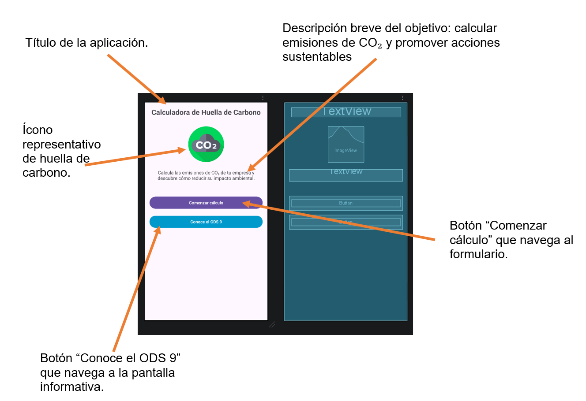
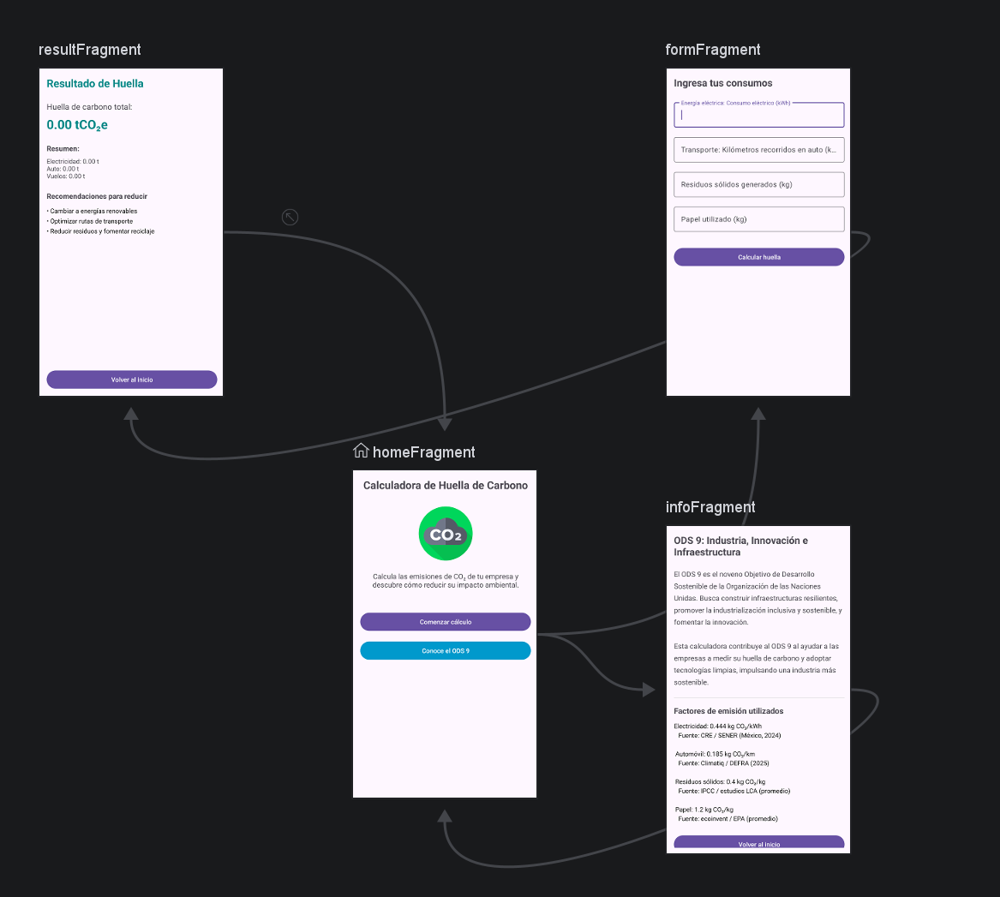

# Reto | Programando una calculadora de huella de carbono para una empresa transnacional en Android

La aplicación utiliza Navigation Component con un NavHostFragment, un NavController y un NavGraph con 4 destinos:
1.	homeFragment – Menú principal.
2.	formFragment – Formulario de consumos.
3.	resultFragment – Resultados y recomendaciones.
4.	infoFragment – Información del ODS 9 y fuentes de factores de emisión

